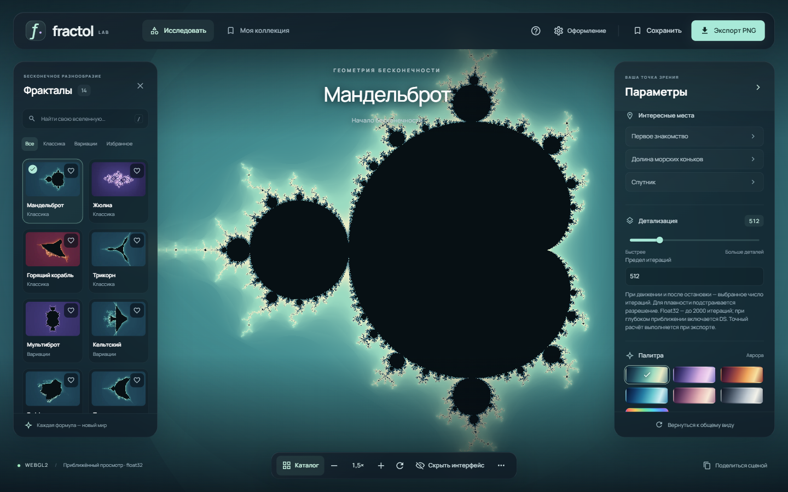
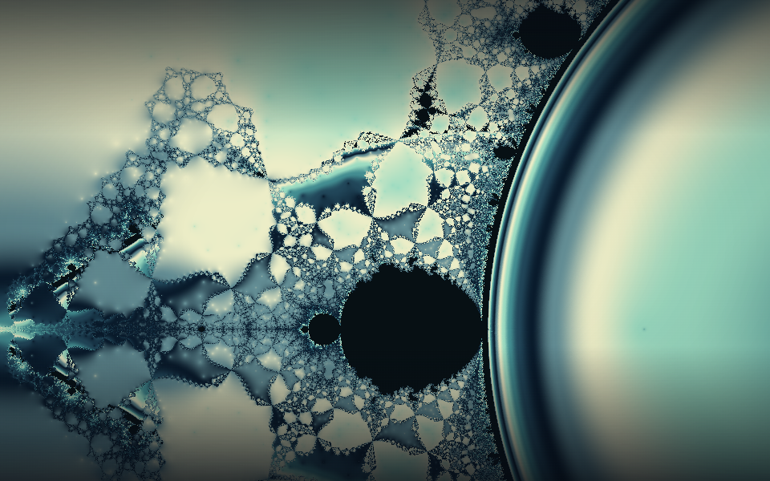
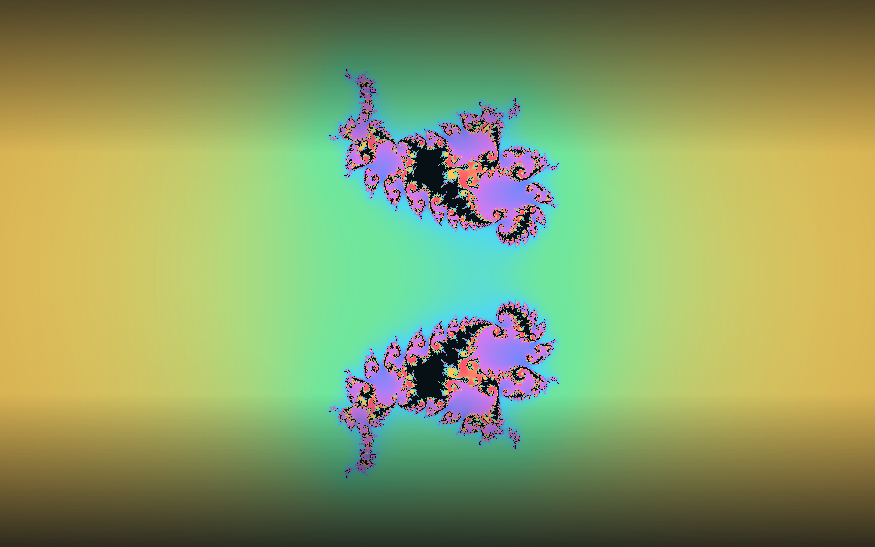

# Fractol Lab

Исследуйте фракталы, находите необычные узоры и сохраняйте свои открытия. Всё изображение рассчитывается на видеокарте — прямо в браузере.



**14 фракталов · 7 палитр · готовые сцены · локальная коллекция · PNG**

Начните с Мандельброта, изменяйте константу Жюлиа или откройте цветные области притяжения Ньютона. Панели можно скрыть, чтобы оставить только изображение и навигацию.

## Попробовать локально

Нужен [Node.js](https://nodejs.org/) **22.12 или новее**.

```sh
npm ci
npm run dev
```

Откройте **http://127.0.0.1:5173/**. Для сборки статического сайта:

```sh
npm run build
npm run preview
```

Готовые файлы находятся в `dist/`. Приложению нужен HTTP-сервер; серверная часть и база данных не требуются.

Для проверки на телефоне или планшете в одной сети с компьютером см. [запуск по Wi-Fi](docs/DEVELOPMENT.md#проверка-по-wi-fi).

## Что можно делать

| Исследовать | Настроить | Сохранить |
| --- | --- | --- |
| Выбирать фракталы и интересные места | Менять палитру и детализацию | Создавать именованные сцены |
| Приближать колесом или щипком | Выбирать качество и режим ресурсов | Делиться ссылкой на участок |
| Перемещаться и отменять действия | Скрывать панели и размытие | Переносить коллекцию и скачивать PNG |

Обычный режим использует быстрый приближённый просмотр float32/DS. **Экономный режим** уменьшает разрешение и ограничивает детализацию и частоту — он доступен на любом устройстве и автоматически выбирается по мобильным возможностям браузера.

**Быстрый PNG** сохраняет готовое изображение просмотра. **Точный PNG** отдельно рассчитывается в binary64 и может потребовать ожидания. Большой зум или число итераций увеличивают работу; фиксированная частота кадров для любого устройства не гарантируется.

## Несколько направлений для исследования

| Ньютон | Нова | Феникс |
| :---: | :---: | :---: |
|  |  |  |
| Корни и границы притяжения | Возмущённый метод Ньютона | Орбиты с памятью |

Изображения получены самим GPU-рендерером Fractol.

## Управление

| Действие | Мышь / touch | Клавиатура |
| --- | --- | --- |
| Приблизить или отдалить | Колесо / щипок | `+` / `−` |
| Переместиться | Перетаскивание | Стрелки |
| Вернуться к общему виду | Кнопка сброса | `Home` |
| Скрыть или показать интерфейс | Подписанная кнопка с глазом | `F` |
| Отменить / повторить | Меню `…` | `Ctrl/Cmd+Z` / `Ctrl/Cmd+Shift+Z` |

Коллекция и настройки остаются в текущем браузере. Экспортируйте коллекцию в JSON перед очисткой данных сайта. Данные сцен не отправляются на сервер; шрифты, иконки и миниатюры поставляются вместе с приложением.

**[Руководство пользователя →](docs/USER_GUIDE.md)** — режимы, ссылки, экспорт и бенчмарк.  
**[Знакомство с фракталами →](docs/FRACTALS.md)** — иллюстрированный путеводитель по всем 14 мирам без сложных формул.  
**[Руководство разработчика →](docs/DEVELOPMENT.md)** — устройство приложения, сборка и проверки.

Для работы нужен WebGL2 с аппаратным ускорением. Совместимость и скорость зависят от браузера и GPU; эмуляция мобильного экрана не заменяет проверку реального телефона. Сведения о сторонних компонентах: [уведомления и лицензии](THIRD_PARTY_NOTICES.md).

## Лицензия

Собственный код проекта — [MIT](LICENSE), Copyright (c) 2026 Dkyle. Сторонние компоненты сохраняют свои [лицензии и уведомления](THIRD_PARTY_NOTICES.md).
