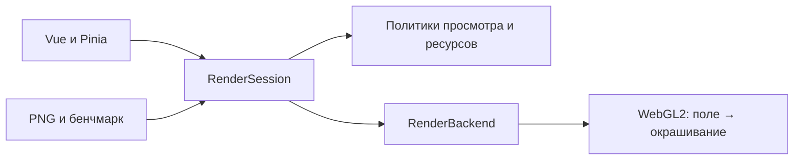

# Разработка Fractol

[← К проекту](../README.md) · [Пользовательское руководство](USER_GUIDE.md)

Fractol — статическое приложение на Vue 3, TypeScript, Vuetify, Pinia и Vite. Геометрия рассчитывается локально на GPU через WebGL2. Внешние API, серверная часть и учётные записи для работы приложения не нужны.

## Среда и команды

Нужен Node.js **22.12+**. Версии зависимостей закреплены в lockfile.

```sh
npm ci
npm run dev
```

Сервер открывается на `http://127.0.0.1:5173/`. Сборка и просмотр:

```sh
npm run build
npm run preview
```

`build` выполняет строгую проверку TypeScript и создаёт `dist/`. Файлы можно разместить на статическом HTTP-сервере; `file://` не поддерживается. Публикация не входит в эти команды.

### Проверка по Wi-Fi

Подключите телефон или планшет к тому же роутеру, что и компьютер. Компьютер может быть подключён кабелем. В Windows выполните `ipconfig` и найдите IPv4-адрес активного Ethernet/Wi-Fi адаптера с основным шлюзом, а не адрес VPN или виртуального адаптера.

Из корня проекта запустите Vite напрямую, заменив `192.168.1.100` своим адресом:

```sh
node node_modules/vite/bin/vite.js --host 192.168.1.100 --port 5174 --strictPort
```

На мобильном устройстве откройте `http://192.168.1.100:5174/`. Оставьте терминал работающим; `Ctrl+C` остановит сервер. Если порт занят, выберите другой и измените его в адресе. Прямая команда не требует передачи флагов через `npm`.

При запросе Windows разрешите Node.js доступ в частной сети. Если страница недоступна, проверьте брандмауэр, VPN и изоляцию клиентов гостевой Wi-Fi сети. Сервер предназначен для проверки в доверенной локальной сети. `localhost` на телефоне обозначает сам телефон.

Для замеров используйте production-сборку вместо dev-сервера:

```sh
npm run build
node node_modules/vite/bin/vite.js preview --host 192.168.1.100 --port 5174 --strictPort
```

HTTP достаточно для рендеринга WebGL2 и PNG. На локальном HTTP-адресе браузер может ограничить доступ к буферу обмена; это не ошибка GPU. При изменении адреса или порта сохранения прежнего адреса не переносятся автоматически — используйте JSON коллекции.

## Устройство приложения



| Область | Ответственность |
| --- | --- |
| `src/domain/` | Чистые типы, формулы, камера, история, коллекция, качество и численные ограничения |
| `src/stores/` | Команды пользовательской сцены и коллекции, границы действий истории |
| `src/rendering/` | Сессия, задания, WebGL-ресурсы, GLSL, подготовка программ, измерения и экспорт |
| `src/components/`, `src/composables/` | Интерфейс, ввод и компоновка |
| `src/infrastructure/` | Хранилище, предпочтения, сведения устройства и скачивание файлов |

Компоненты меняют сцену командами store и работают с рендерингом через сессию. GPU-ресурсы и сырые измерения остаются вне глубокой реактивности. Домен не импортирует Vue, Pinia или WebGL; рендеринг не импортирует Vue/Pinia.

Начните чтение с [RenderSession](../src/rendering/session.ts) и [контракта бэкенда](../src/rendering/backend.ts). Выбор арифметики и пределы координат находятся в [политике просмотра](../src/domain/viewing.ts), ограничения экономного режима — в [политике ресурсов](../src/domain/resources.ts). Определения и пресеты собраны в [каталоге](../src/domain/catalog.ts), независимый CPU-эталон — в [reference.ts](../src/domain/reference.ts).

## Конвейер и точность

Первый проход рассчитывает поле в RGBA8, второй применяет палитру. Цвет не входит в математический ключ сцены: его изменение не повторяет орбиты. Новое поле сбрасывает прежний ключ готовности до отправки; ревизия задания и поколение контекста защищают от устаревших результатов.

Выход, сходимость, исчерпание итераций, особенность и численная ошибка — разные исходы. Неизвестное покрытие при перепроекции также не является внутренней областью множества. Кодирование и декодирование описаны в [outcomes.ts](../src/rendering/outcomes.ts); численные критерии формул и порядок операций нельзя менять ради рефакторинга.

Обычный просмотр использует float32 до 2000 итераций при достаточном различии координат, иначе — проверенный double-single. Во время жеста число итераций N не снижается. В экономном режиме всегда float32 и `min(N, 512)`, DPR ≤ 1, не более 600 000 пикселей и до 30 Гц; обычные пределы — DPR ≤ 1,5 и 3 000 000 пикселей. Через 150 мс покоя восстанавливается итоговая сетка своего режима. Неподвижная готовая сцена не запускает постоянную отрисовку.

Binary64 подготавливается лениво только для точного PNG. Координаты, орбита и классификация используют программную binary64; после классификации цветовой скаляр может использовать float32. Точный экспорт получает независимый снимок с выбранным N и временные ресурсы, не вытесняя экран; допускается одно готовое поле в кэше.

Минимальная высота камеры просмотра:

```text
M = max(1, abs(x), abs(y))
H = max(1080, итоговая высота framebuffer)
DS:      max(1e-12, 8 × M × H × 2^-40)
float32: max(1e-5,  8 × M × H × 2^-23)
```

Это защита различимости координат, не гарантия точности чувствительных орбит. Глубокая исходная сцена сохраняется отдельно от камеры обзора.

Тяжёлые DS/точные задачи выполняются отменяемыми порциями, ориентиры — 3 мс для DS и 6 мс для binary64, очередь не больше двух. Опрос GPU fence неблокирующий, с `timeout=0`; отправленная работа завершается перед освобождением ресурсов. Поколение контекста проверяется до доступа к ресурсам. Повторяемая ошибка одного запроса останавливает автоматические повторы в покое.

Вычислительные timer-query заканчиваются до окрашивания; отдельные `color`-образцы исключены из метрик вычисления. Время CPU, fence и подготовки не называется GPU-временем. Самопроверки арифметики обязательны; CPU-эталон независим от GPU-генератора.

Сессия передаёт видимость в бэкенд: скрытый экран не выполняет предъявления, в том числе из ожидания подготовки программы. Уже отправленная компиляция может завершаться и сохраняться в кэше.

Для явного `julia-pointer` сессия сохраняет одно выполняющееся задание и последний ожидающий снимок константы. Оно публикуется атомарно из back-поверхности после завершения; предыдущий кадр остаётся на экране с пояснением. Через 150 мс покоя устаревшая работа отменяется один раз и запускается последняя сцена с итоговым разрешением. Камера, числовой ввод и другие структурные изменения не получают эту политику автоматически. Быстрый PNG требует готовности актуального снимка.

GPU-кэш просмотра хранит только завершённые итоговые поля после остановки ввода: до 32 МиБ/8 записей в standard, 4 МиБ/4 записи в economy. Незавершённые GPU-копии входят в бюджет. Ключ содержит фактическую математику, арифметику/версию, кодирование и размеры; цвет исключён. Записи неизменяемы, копируются GPU-only и удаляются по LRU, при скрытии/потере контекста/dispose. Отказ выделения отключает заполнение до восстановления. Это дополнительная собственная память, не оценка общего потребления VRAM. Кэш PNG независим.

Методика `fractol-navigation-v6-events` использует общий поток уникальных событий backend → session → сборщик. Отдельно считаются отправки вычислений, наблюдения готовности GPU, тайлы и отправки изображения (целое поле/тайл/перепроекция/повтор/кэш). Для float32 fence опрашивается без блокировки и без ожидания перед следующей обычной отправкой; DS использует существующие завершения. Моменты наблюдения fence и отправки изображения не равны физическим кадрам монитора. Одинаковые временные отметки допустимы.

Бенчмарк хранит фактические монотонные границы окна, счётчики обоих краёв, события и действительные GPU-query. После конца окна поздние query собираются до 500 мс по времени отправки; ожидание не входит в длительность. Кэш просмотра обойдён на время теста. UI/CLI используют один сборщик, v6 не сравнивается напрямую со старыми снимками статистики. Сырые массивы остаются вне глубокой реактивности. Диагностический `setNavigationFeatures` позволяет парно отключать объединение Julia и кэш с тем же измерителем, без пользовательской настройки.

Подготовка, фактический прогрев, измерительное окно, сбор поздних query и ожидание итогового неподвижного поля записываются раздельно. Последнее ожидание можно остановить; оно не улучшает частоты измерительного окна. Максимальная задержка поля считается от его отправки до наблюдения готовности, отдельно от интервалов между готовыми полями и GPU-времени. Быстрый PNG становится доступен после наблюдения готовности актуального поля.

Видимая диагностика показывает накопленные за сессию отправки изображения, готовые GPU-поля, тайлы, восстановления и отдельную память кэша просмотра. Последний GPU-образец подписан по виду работы: просмотр, окрашивание или PNG. Эти счётчики не являются частотами измерительного окна. Во время ввода Vue-снимки статистики обновляются не чаще одного раза в 250 мс; готовность итогового неподвижного поля публикуется сразу. Полный поток событий v6 не зависит от этой частоты и не теряет события.

GPU p50/p95 описывают отдельные вычислительные query: поле float32 или порцию DS, в зависимости от исполнителя. Они не равны GPU-времени целого DS-поля, задержке интерфейса или времени вывода на монитор. Число образцов и арифметику следует учитывать при сравнении. Atomic-float путь опрашивает готовые query во время работы, чтобы слоты измерителя не заполнялись данными прогрева.

## Данные и совместимость

Сцены имеют `schemaVersion=1`, формулы `formulaVersion=1`, коллекция `Library.version=1`. Параметры нормализуются по определению; некорректные внешние данные отклоняются. Настройки ресурсов, качества, стекла и панелей не попадают в сцену, URL или историю.

Ссылка хранит снимок в URL fragment. Коллекция и предпочтения — в localStorage; нет автоматического восстановления последней камеры. История ограничена 100 шагами текущей вкладки. Старые сцены с 64–16384 итерациями не обрезаются редактором 64–2000 или экономным режимом автоматически. Точный PNG имеет отдельный предел 64–16384.

## Проверки

```sh
npm test
npm run test:tools
npm run build
npm run test:browser
```

Браузерный набор использует установленный Chrome; Edge — `npx playwright test --project=edge`. Chrome и Edge должны быть установлены в системе. Дополнительные тестовые движки устанавливаются отдельно:

```sh
npx playwright install firefox webkit
npm run test:browser:all
```

Playwright запускает или переиспользует Vite на порту 5173; предусмотрен один worker. В наборе остаются рабочие проверки без зависимости от локальной истории. WebKit на Windows не считается физическим Safari, touch-эмуляция — проверкой телефона.

### Автоматическая проверка GitHub

[Workflow Checks](../.github/workflows/ci.yml) выполняет `npm ci`, `npm test`, `npm run test:tools` и `npm run build` при push и pull request. Среда — Ubuntu и Node.js 22; Actions закреплены полными SHA, права ограничены чтением репозитория. Node.js 22.12 — минимальная версия для локальной работы.

Браузерные GPU-проверки и аппаратные замеры выполняются отдельно: обычная виртуальная машина CI не является приёмкой видеокарты. До первого запуска на GitHub workflow проверен только локально по составу и командам, без утверждения об успешном облачном прогоне.

Для проверки production-сборки выполните `node scripts/production-check.mjs` после `build`; порт 4173 должен быть свободен. Сервер и браузер, созданные сценарием, закрываются после проверки.

Для стандартного измерения при работающем dev-сервере: `npm run benchmark`. Полная последовательная серия Chrome/Edge: `node scripts/benchmark-acceptance.mjs`. GPU-тесты, бенчмарки и захват изображений нельзя запускать параллельно. При сравнении фиксируйте браузер, GPU, питание, размер окна/DPR, фактическую сетку, режим ресурсов и фоновую нагрузку.

Цели обычного режима — 60 новых полей/с и p95 ≤ 20 мс, экономного — 30 полей/с и p95 ≤ 40 мс. Они не гарантированы для любой сцены, высоких N или любого устройства. Перепроекции и повторные предъявления учитываются отдельно. Глубокий DS, холодная подготовка отдельных программ и долгий точный PNG остаются ограничениями; успешные тесты не закрывают аппаратную приёмку.

## Изображения, инструменты и локальные результаты

Публичные скриншоты находятся в `docs/images/`, миниатюры — в `public/thumbnails/`. `npm run thumbnails` пересоздаёт миниатюры теми же GPU-формулами и требует работающий Vite. `node scripts/licenses.mjs` обновляет уведомления установленных сторонних компонентов; лицензии и `THIRD_PARTY_NOTICES.md` входят в проект.

Собственный код распространяется по [MIT](../LICENSE). [Уведомления сторонних компонентов](../THIRD_PARTY_NOTICES.md) указывают на полные тексты в `public/licenses/`; эти тексты попадают и в статическую сборку. Генератор обновляет копии npm-лицензий и общий указатель, но не заменяет отдельный текст SoftFloat общим документом.

Диагностические инструменты сохраняют новые результаты в `.local/runs/`, в отдельном каталоге запуска. Переменная `FRACTOL_RUN_DIR` может задать новый или пустой каталог внутри этой области. Связанные дочерние инструменты автоматически наследуют владение тем же запуском; отдельная повторная команда не может занять старый каталог и перезаписать результаты. Результаты не требуются для запуска, сборки и обычных тестов.

История проекта и остановленные эксперименты могут локально находиться в `.local/project/`. Они игнорируются Git и не поставляются в production. Их отсутствие в чистой копии ожидаемо. Текущие инструкции для работы с кодом — [AGENTS.md](../AGENTS.md).
