# Фракталы: маленький путеводитель по бесконечным узорам

[← К проекту](../README.md) · [Как пользоваться приложением](USER_GUIDE.md)

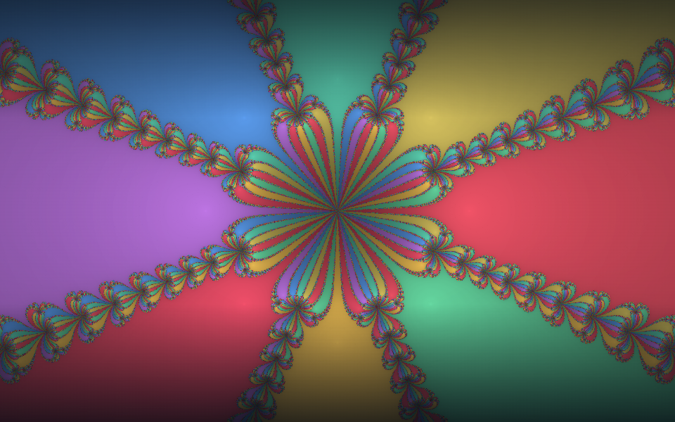

*Это Ньютон — один из 14 фракталов Fractol. Картинка получена самим приложением. Цветы и перья здесь — образы, которые можно увидеть в узоре.*

Чтобы наслаждаться фракталами, не нужно разбираться в формулах. Можно просто выбрать интересный силуэт, приблизить его край и посмотреть, что там происходит.

## Откуда берётся такая красота

Представьте правило: взять число, изменить его и повторить то же действие с результатом. Компьютер делает это для множества точек, а затем показывает их поведение цветом. Простое правило может создать очень сложное изображение.

У фрактальных узоров похожие мотивы часто встречаются на разных масштабах: завиток распадается на меньшие завитки, а вокруг большого острова обнаруживаются маленькие. **Похожесть не означает, что весь рисунок состоит из одинаковых копий.** Приближение может открывать и новые формы.

Кораллы, облака и ветви деревьев помогают представить такое повторение деталей. Но изображения ниже получены математическим расчётом, а не фотографированием природы.

В этом путеводителе «крылья», «пламя», «кружево» и «острова» — зрительные ассоциации. У каждого человека они могут быть своими.

## Как смотреть на изображение

**Силуэт** помогает узнать фрактал издалека. **Граница** часто оказывается самым интересным местом для приближения. **Цвет** помогает заметить различия в расчёте: например, сколько шагов понадобилось точке, чтобы уйти далеко или приблизиться к определённой цели.

Цвета выбирает палитра. Они не закреплены за формулой: один и тот же узор можно сделать похожим на северное сияние, тлеющие угли или серебряный рельеф.

**Тёмное пятно не всегда означает одно и то же.** У Мандельброта оно может означать, что точка не ушла за предел за выбранное число шагов. У Ньютона или Новы — что расчёт не установил нужный результат, встретил особенность или численную проблему. Это не универсальное обозначение «пустоты» или «внутренности».

Все миниатюры ниже получены GPU-рендерером Fractol. Они показывают выбранный ракурс и палитру; при других настройках тот же фрактал может выглядеть иначе. Маленькая миниатюра передаёт силуэт, но не всё богатство деталей.

## С чего начать

| Если хочется увидеть… | Попробуйте |
| --- | --- |
| Знакомый силуэт и маленькие миры по краям | [Мандельброт](#мандельброт) |
| Завитки, которые меняются от движения указателя | [Жюлиа](#жюлиа) |
| Мачты, башни и огненные берега | [Горящий корабль](#горящий-корабль) |
| Звёзды и строгую симметрию | [Трикорн](#трикорн), [Мультиброт](#мультиброт) |
| Цветные области и ажурные границы | [Ньютон](#ньютон) |
| Складки и необычные очертания | [Кельтский](#кельтский), [Буффало](#буффало), [Перпендикуляр](#перпендикуляр) |
| Узор с памятью | [Феникс](#феникс) |

## Знакомые формы и симметрия

### Мандельброт

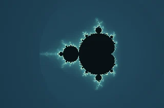

**На что похож:** большой округлый остров с цепочкой спутников.

Здесь каждая точка картинки задаёт свой вариант одного правила. Главная форма легко узнаётся, а её края скрывают спирали, тонкие нити и маленькие подобия большого силуэта. Эти детали хорошо видны при исследовании границы; о них рассказывает и [справка Ultra Fractal](https://www.ultrafractal.com/help/formulas/standard/mandelbrot.html).

**Что искать:** переходы между крупными округлыми частями и маленькими «бусинами» рядом с ними.

**Попробуйте:** «Первое знакомство» → «Долина морских коньков». Это готовые сцены в разделе «Интересные места».

### Жюлиа

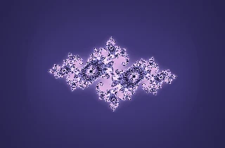

**На что похожа:** кружево, ветвистый кристалл или россыпь островов.

Если Мандельброт показывает карту вариантов правила, то здесь выбран один вариант, а точки картинки задают разные начальные положения. Изменение константы меняет весь узор. Поэтому у Жюлиа столько разных лиц. Подробнее о родстве этих двух семейств — в [описании Жюлиа](https://www.ultrafractal.com/help/formulas/standard/julia.html).

**Что искать:** повторяющиеся завитки и то, как тонкие перемычки связывают части изображения.

**Попробуйте:** «Спиральная галактика», затем включите «Изменять указателем» и двигайтесь медленно. На сенсорном экране можно начать с готовых сцен и числовых параметров.

### Горящий корабль

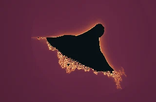

**На что похож:** корпус корабля, огненный берег или фантастический город.

В правило добавлены отражения координат. Они меняют характер линий: появляются складки, вытянутые выступы и структуры, напоминающие мачты. Красота этого фрактала — в сочетании спокойного крупного силуэта с очень насыщенным краем.

**Что искать:** башни и тонкие вертикальные детали в сцене «Пылающие мачты».

**Попробуйте:** «Корабль целиком» → «Пылающие мачты» и палитру «Тлеющий огонь». Огонь — впечатление от формы и цвета, а не изображение физического пламени.

### Трикорн

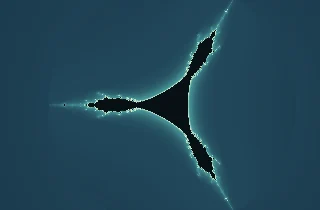

**На что похож:** трёхлучевая звезда или знак из трёх изогнутых рогов.

На каждом шаге правило включает зеркальное отражение. Вместо привычной округлой фигуры получается характерная тройная симметрия. Издалека она выглядит строгой и простой, но по краям лучей начинается мелкая работа линий.

**Что искать:** переход от широкого центра к тонким окончаниям и маленькие островки рядом с ними.

**Попробуйте:** «Три луча» → «Западный луч». Сравните общий силуэт и его фрагмент.

### Мультиброт

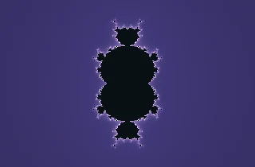

**На что похож:** симметричный орнамент, который перестраивается при смене степени.

Это родственник Мандельброта с изменяемой степенью в правиле. В Fractol доступны целые значения от 2 до 8. При степени 2 получается обычный вариант Мандельброта; другие значения меняют симметрию и крупные выступы.

**Что искать:** как одна настройка перестраивает весь силуэт, сохраняя богатую границу.

**Попробуйте:** «Третий порядок» → «Семь лепестков». Во второй сцене степень равна 8: название описывает рисунок, а не значение поля.

## Складки, отражения и необычные берега

### Кельтский

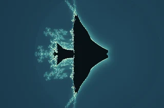

**На что похож:** сложенная бумага с кружевным краем.

В этой версии отражается одна часть промежуточного результата. На картинке заметно соседство резких складок и мягких россыпей деталей. Название может напоминать кельтский орнамент, но настоящие переплетённые ленты здесь искать необязательно.

**Что искать:** места, где почти прямая линия вдруг распадается на мелкие ответвления.

**Попробуйте:** «Кельтский узел» → «Переплетение». Приближайте край, а затем немного отдаляйтесь, чтобы увидеть его место в общей форме.

### Буффало

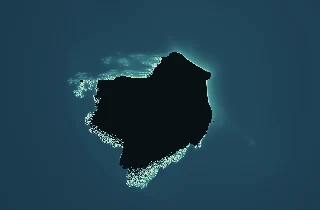

**На что похож:** неровный остров или вырезанный из камня силуэт.

Здесь отражаются обе части промежуточного результата. Такая небольшая перемена правила создаёт другую геометрию: заломы, выступы и неодинаковые по характеру участки границы.

**Что искать:** чередование спокойных дуг и плотно собранных складок. Попробуйте мысленно проследить контур, как берег на карте.

**Попробуйте:** «Силуэт» → «Складки». Не нужно обязательно узнавать в фигуре животное: название не является заданием на поиск изображения.

### Перпендикуляр

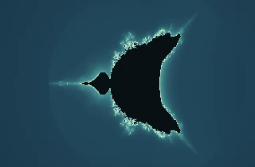

**На что похож:** изогнутый берег с острым мысом.

У этого варианта иначе отражается одна из составляющих шага. Получается узнаваемое родство с Мандельбротом, но с другими изгибами и складками. Особенно интересно сравнивать похожие выступы двух фракталов.

**Что искать:** узкие переходы между крупной формой и маленькими спутниками.

**Попробуйте:** «Отражение» → «Граница». Палитра «Серебро» поможет сосредоточиться на контуре, если яркие цвета отвлекают.

## Притяжение, память и неожиданные узоры

### Ньютон

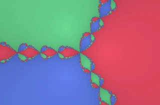

**На что похож:** цветная карта, у которой границы превращаются в ажурный орнамент.

Здесь расчёт [ищет решения уравнения методом Ньютона](https://www.ultrafractal.com/formulas/reference/Standard/Standard_Newton.html). Разные начальные точки приходят к разным решениям. В Fractol цвет различает найденные решения, а яркость зависит от скорости приближения. Область точек, приходящих к одной цели, называется **областью притяжения**.

**Что искать:** места встречи цветов. Далеко от границы всё кажется простым, а рядом с ней соседние точки могут получить разные результаты.

**Попробуйте:** «Три области притяжения» → «Пять направлений» → «Восемь корней», палитра «Спектр». Степень от 3 до 8 задаёт количество решений, к которым может прийти расчёт. Большая иллюстрация в начале путеводителя тоже показывает Ньютона.

### Нова

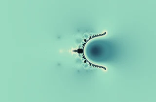

**На что похожа:** светящаяся дуга или необычный берег.

Это [родственник метода Ньютона](https://www.ultrafractal.com/formulas/reference/Standard/Standard_NovaMandel.html): на каждом шаге к результату добавляется величина, зависящая от точки картинки. Возникает другой мир узоров. Настройка «Релаксация» меняет силу поправки, а цвет в этой реализации показывает скорость сходимости — насколько быстро движение почти перестаёт меняться.

**Что искать:** мелкие ветви вдоль дуг и переходы между гладким свечением и сложной кромкой.

**Попробуйте:** «Рождение Новы» → «Медленное притяжение» → «Возмущённые берега». Эти сцены отличаются и камерой, и настройками, поэтому для сравнения только релаксации меняйте её в одном выбранном ракурсе.

### Феникс

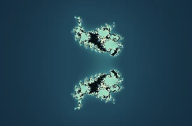

**На что похож:** пара крыльев, островная цепь или ветвистый след.

У Феникса есть [память предыдущего состояния](https://www.ultrafractal.com/formulas/reference/Standard/Standard_PhoenixJulia.html): следующий шаг зависит не только от текущего числа. В Fractol можно менять силу этой памяти. Если установить её в 0, получится вариант Жюлиа с той же константой.

**Что искать:** повторяющиеся островки и то, как между ними распределено свободное пространство. Иногда общий рисунок лучше виден издалека, чем при сильном приближении.

**Попробуйте:** «Крылья Феникса» → «Острова памяти» → «Julia без памяти». Последняя сцена помогает увидеть, что остаётся без дополнительного влияния прошлого шага.

### Магнит 1

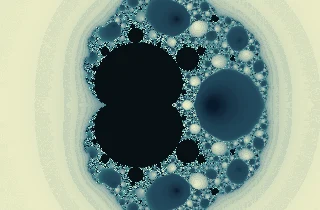

**На что похож:** узор из пузырьков, колец и округлых островов.

У этого правила [два важных исхода](https://www.ultrafractal.com/formulas/reference/Standard/Standard_Magnet1Mandelbrot.html): последовательность может приближаться к одной выделенной точке или уходить далеко. Fractol окрашивает эти результаты разными участками палитры. Название не означает, что приложение моделирует движение настоящих магнитов.

**Что искать:** соседство крупных круговых областей с россыпью совсем маленьких и переходы между ними.

**Попробуйте:** «Магнитное поле» → «Полюс и острова» → «Северная граница».

## Два фрактала из истории проекта

Эти варианты перенесены из исходного Fractol на C. Они сохраняют собственные правила и порядок действий, поэтому их стоит воспринимать как отдельные миры.

### Корабль · 2019

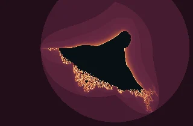

**На что похож:** знакомый корабль в другом освещении, с заметными полосами вокруг.

Он родственен «Горящему кораблю», но отражение выполняется в другом месте расчёта, а начальное значение тоже отличается. Поэтому это не просто другая палитра стандартного корабля. В этой реализации окрашивание использует целое число шагов: широкие полосы могут оставаться заметной частью рисунка.

**Что искать:** различия в контуре и расположении мелких деталей по сравнению с «Горящим кораблём».

**Попробуйте:** «Оригинал» → «По следам прошлого». Для сравнения двух формул сначала выберите одинаковую палитру.

### Something

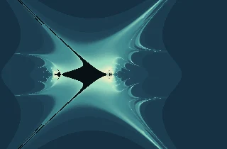

**На что похож:** силуэт летучей мыши, парус или натянутая ткань.

Авторский эксперимент исходного проекта. Внутри одного шага уже обновлённая часть результата влияет на следующую, а сама добавляемая величина тоже меняется. Получается другой характер линий: рядом с острыми концами видны широкие плавные изгибы.

**Что искать:** переход от центральной фигуры к большим окружающим дугам. Здесь интересно рассматривать не только мелкие детали, но и композицию целиком.

**Попробуйте:** «Эксперимент» → «Внутренняя структура».

## Небольшая прогулка по Fractol

1. Откройте **Мандельброта** и сцену «Долина морских коньков». Выберите один завиток и приблизьте его край.
2. Перейдите к **Жюлиа** и посмотрите, как смена константы перестраивает весь рисунок.
3. У **Мультиброта** поменяйте степень: здесь легко увидеть влияние одного параметра на общую форму.
4. Откройте **Ньютона** со «Спектром» и сравните крупные цветные области с их границами.
5. В **Фениксе** сравните готовые сцены с памятью и без неё. Сохраните понравившийся ракурс в коллекцию.

Названия сцен в тексте совпадают с разделом **«Параметры → Интересные места»**. Выбор сцены может менять и ракурс, и математические параметры; палитра при этом остаётся выбранной вами.

## Как находить свои красивые кадры

- **Приближайте границу.** В центре большой одноцветной области новых деталей может быть мало.
- **Иногда отдаляйтесь.** Маленький красивый фрагмент становится ещё интереснее, когда видно его место в общем узоре.
- **Меняйте одну настройку за раз.** Так проще заметить, что именно изменило изображение.
- **Попробуйте другой цвет.** «Аврора» подчёркивает мягкое свечение, «Тлеющий огонь» — тёплые края, «Серебро» помогает смотреть на форму. Это способы оформления, а не свойства самого фрактала.
- **Не гонитесь сразу за максимальной детализацией.** Её значение — предел числа шагов расчёта для точки. Это не резкость фотографии, и большее число не всегда делает композицию интереснее.
- **Сохраните находку.** Быстрый PNG сохраняет готовый просмотр; точный PNG рассчитывает исходную сцену отдельно и может потребовать ожидания. На чувствительных границах их детали могут различаться.

Математические фракталы позволяют говорить о деталях на сколь угодно малом масштабе, но экран и вычисления имеют конечную точность. Fractol ограничивает приближение, чтобы координаты оставались различимыми. Красивый кадр можно найти задолго до этого предела.

Описания относятся к конкретным 14 определениям [каталога Fractol](../src/domain/catalog.ts). У названий «Нова», «Феникс», «Магнит» и других семейств существуют разные варианты; здесь показаны те, которые реализованы в приложении. За управлением, коллекцией и экспортом — в [руководство пользователя](USER_GUIDE.md).
