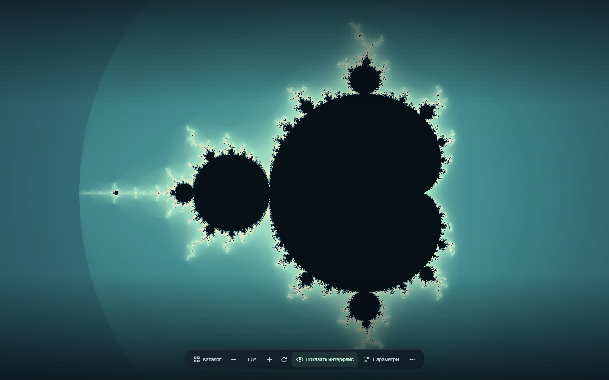
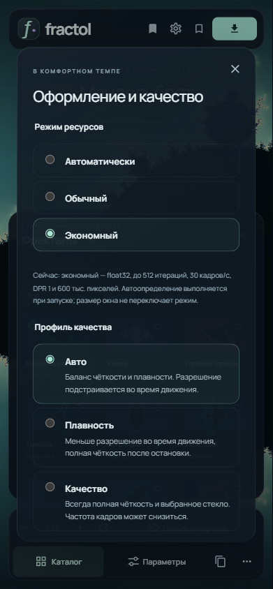
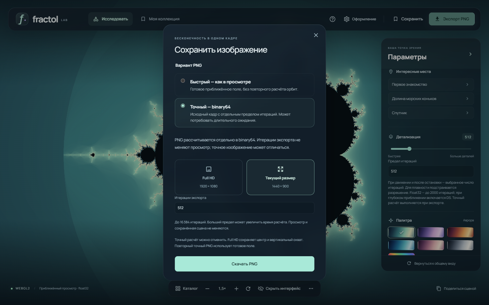

# Исследование Fractol

[← К проекту](../README.md) · [Разработчикам](DEVELOPMENT.md)

## Первое открытие

В каталоге слева выберите фрактал. В «Параметрах» справа откройте одно из интересных мест, подберите палитру и исследуйте участок колесом мыши или щипком. Перетаскивание перемещает изображение. Открытая ссылка сразу воспроизводит сохранённую сцену; без ссылки приложение начинает с Мандельброта.

На небольшом экране каталог и параметры открываются по очереди из нижней навигации. **«Скрыть интерфейс»** оставляет изображение и нижние инструменты. Возврат — той же кнопкой, `F` или `Escape`; открытие каталога или параметров также возвращает интерфейс.

Для локальной проверки на телефоне или планшете есть [инструкция подключения по Wi-Fi](DEVELOPMENT.md#проверка-по-wi-fi). Данные коллекции на телефоне и компьютере хранятся отдельно; переносите их через JSON.

## Детали и цвет

**Детализация** — предел числа итераций для каждой точки, а не размер изображения. Больший предел помогает обнаруживать долгие орбиты, но увеличивает время расчёта. Обычный редактор позволяет выбрать 64–2000. Старые сцены с большим пределом сохраняют его до явного изменения.

Палитра, сдвиг и плотность цвета меняют окрашивание готового поля. Они не запускают расчёт орбит заново. Математические параметры зависят от выбранного фрактала: например, степень у Ньютона или память у Феникса.

Для Жюлиа можно включить **«Изменять указателем»**. Этот режим меняет константу при движении мыши; завершить его можно `Escape` или повторным нажатием переключателя.

Во время непрерывного движения Жюлиа показывает целые готовые кадры, пропуская промежуточные значения указателя. Пока расчёт не догнал выбранную константу, видна подпись «Обновляем параметры Жюлиа; показан предыдущий кадр». Через 150 мс покоя считается последний снимок с итоговым разрешением. Число итераций при этом не уменьшается.

Если обычный расчёт ещё не завершён при первом изменении указателем, он один раз отменяется для перехода к целым кадрам. Последующие движения не перезапускают выполняющийся кадр.

Отмена и повтор находятся в меню **`…`**. Один drag, pinch или движение ползунка образует одно действие. Числовое поле фиксируется при `Enter` или потере фокуса. История действует в текущей вкладке и не сохраняется после перезагрузки.

## Качество и ресурсы

Откройте **«Оформление»** в верхней панели.

| Настройка | Когда пригодится |
| --- | --- |
| **Авто** | Обычное исследование с адаптацией разрешения |
| **Плавность** | Когда важнее отзывчивость во время движения |
| **Качество** | Когда важнее чёткость; частота может снизиться |
| **Лёгкое стекло** | Чтобы отключить размытие панелей |

В обычном режиме выбранные итерации сохраняются при движении. Через 150 мс после остановки возвращается итоговое разрешение.

Отдельный **режим ресурсов** имеет три варианта: «Автоматически», «Обычный», «Экономный». Автоопределение выполняется при запуске по возможностям браузера, а не по ширине окна; ручной выбор имеет приоритет.

Экономный режим постоянно использует float32, до 512 итераций, до 30 обновлений в секунду, DPR не выше 1 и не более 600 000 пикселей. Размытие выключено; ручная настройка стекла сохраняется для обычного режима. Профили качества действуют внутри этих ограничений.

*Узкий экран получен браузерной эмуляцией. Это иллюстрация интерфейса, а не измерение скорости или расхода батареи телефона.*

У сцены с 2000 итерациями экономный просмотр покажет 512, сохранив исходное значение для ссылки и точного PNG. Кнопка **«Установить 512»** явно меняет сцену; действие можно отменить.

## Сцены и коллекция

Нажмите **«Сохранить»**, задайте название и откройте находку в **«Моей коллекции»**. Здесь доступны поиск, сортировка, переименование и удаление. Коллекция содержит до 100 сцен.

**«Поделиться сценой»** копирует ссылку с формулой, камерой, параметрами и цветом. Коллекция, открытые панели и оформление в неё не входят.

Если браузер запрещает копирование, ссылка появляется в адресной строке — её можно скопировать вручную. Это возможно, например, при локальном подключении по HTTP.

Экспорт JSON переносит коллекцию и избранное. Перед импортом показываются новые, повторные и некорректные записи. Нажатие **«Добавить»** объединяет данные; повторный импорт не создаёт копии. Файлы больше 1 МиБ и импорт с превышением 100 сцен не применяются.

Сохранения принадлежат этому браузеру и адресу сайта. Очистка данных сайта их удаляет — JSON удобно использовать как резервную копию.

Недавно завершённые изображения могут оставаться в небольшом GPU-кэше: возвращение через историю или к прежней сцене тогда обходится без повторного расчёта орбит. Кэш временный, имеет строгий предел памяти и очищается при скрытии вкладки. Он не заменяет сохранения коллекции.

## Два варианта PNG

| Вариант | Что сохраняется |
| --- | --- |
| **Быстрый — как в просмотре** | Готовое приближённое поле, его фактическое разрешение и итерации, текущие цвета. Доступен после завершения просмотра; орбиты повторно не рассчитываются. |
| **Точный — binary64** | Исходная сцена, текущий размер или 1920×1080, собственный предел 64–16384. Выбран по умолчанию в обычном режиме. |

В экономном режиме по умолчанию выбран быстрый экспорт. Точный расчёт может занять заметное время: есть подготовка, прогресс и отмена. Изменение итераций в диалоге не меняет сцену, историю или ссылку. Повтор точного экспорта той же математики, размера и предела использует готовое поле; смена только цвета допускает его переиспользование.

Экран использует приближённую арифметику float32/DS; чувствительные детали точного PNG могут отличаться. DS расширяет точность просмотра, но не является binary64.

Если ссылка ведёт глубже допустимого просмотра, приложение показывает **обзор** и отмечает исходный участок рамкой или маленьким маркером. Быстрый файл в этом случае называется «PNG обзора». Точный PNG, ссылка и сохранение продолжают использовать исходный кадр. **«Исследовать обзор»** явно принимает камеру обзора одним отменяемым действием.

## Бенчмарк

В **«Оформление → Бенчмарк»** выберите стандартный набор или текущую сцену. Каждый вариант получает 2 секунды прогрева и 10 секунд измерения, с полным и лёгким стеклом. Стандартный набор временно использует обычный режим ресурсов; текущая сцена сохраняет ваш режим.

После теста добавьте комментарий, модель устройства или процессор и нажмите **«Скачать .md»**. Отчёт содержит доступные сведения о браузере, GPU и устройстве, условия и снимки сцен. Комментарий можно изменить и скачать файл повторно. Все данные остаются локальными.

Бенчмарк различает новые вычисленные поля и перепроекции прежнего изображения. Скорость предъявления не означает столько же новых расчётов. Недоступное GPU-время не заменяется временем JavaScript. Resize, скрытие вкладки или потеря контекста прерывают тест с объяснением.

Методика v6 отдельно считает готовые поля, опубликованные тайлы и отправки изображения; это не измерение физических кадров монитора. Частоты рассчитываются по фактическому времени. Кэш просмотра на время теста отключается. В Markdown есть границы окна и данные событий для воспроизведения статистики; ожидание поздних GPU-образцов до 0,5 с не входит в измеренное время.

## Если изображение не появляется

- Убедитесь, что браузер поддерживает WebGL2 и аппаратное ускорение включено.
- Попробуйте экономный режим, «Плавность» или меньше итераций для просмотра.
- При потере WebGL-контекста приложение восстанавливает текущую сцену. Незавершённую операцию можно запустить снова после восстановления.
- Для точного PNG дождитесь завершения или нажмите отмену. Увеличение итераций не исправляет недостаточную точность экранных координат.

`/` открывает поиск, `Home` возвращает общий вид, `Ctrl/Cmd+Z` отменяет действие, `Ctrl/Cmd+Shift+Z` или `Ctrl+Y` повторяет. В полях сохраняется стандартная работа с текстом. `Escape` сначала закрывает меню или диалог.
